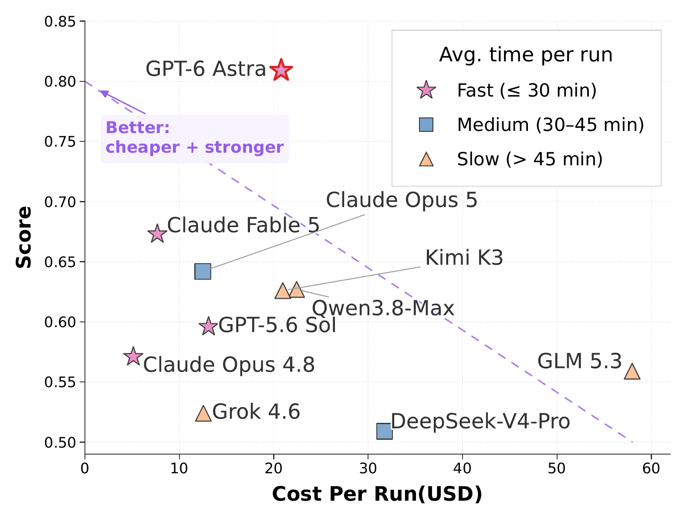
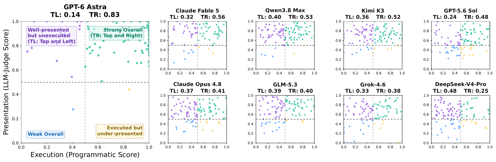
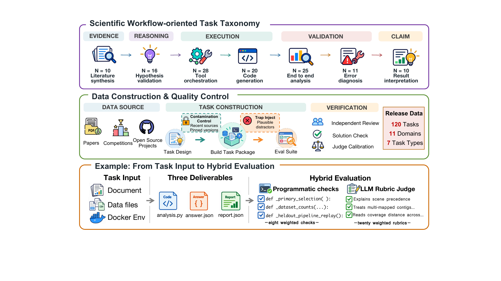
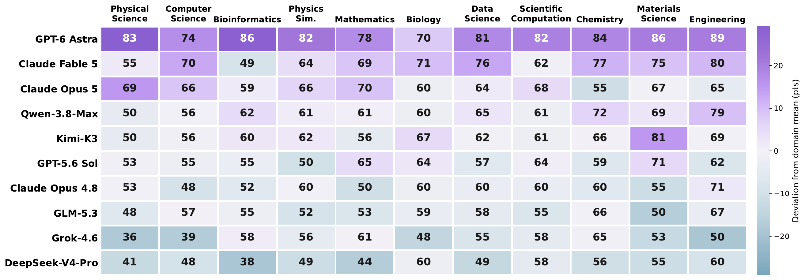

# Sci-Agent-Exam

**Sci-Agent-Exam: Evaluating LLM Agents on Real Scientific Software Workflows**

🔗 **Links:** Paper (under anonymous review) · [Leaderboard](leaderboard/index.html)

Sci-Agent-Exam is a workflow-oriented benchmark for LLM **agents** doing real
scientific software engineering. Unlike final-answer science QA, every task drops
an agent into a Docker environment with real datasets, source code, and mounted
papers, and asks it to *deliver working artifacts* — code, result tables, a
figure, a short report, and a machine-readable `answer.json` — which are then
scored by a **hybrid verifier** (deterministic programmatic checks **+** an
LLM-judge rubric).


This repository is a compact, self-contained **extract** of that benchmark: the
**harbor run logic** that drives one evaluation end-to-end, **five complete
example tasks** spanning five domains and five task types, and the **leaderboard**
of the full evaluation. Large-scale batch runners and the complete task set are
omitted; everything needed to understand and reproduce a single evaluation is
included. The layout follows the
[Terminal-Bench-Science](https://terminal-bench-science.ai/) conventions, driven
by the [`harbor`](https://github.com/harbor-framework/harbor) runner.

## Results snapshot

Across **10 frontier agents** evaluated on the full task set (11 scientific
fields, 7 task types), **GPT-6 Astra** serves as a frontier reference at **80.9**
combined; among the remaining contenders **Claude Fable 5** leads at **67.3**.
The expensive-is-not-better story is clear — per-run cost spans **$5–58** with no
correlation to rank, and even the strongest agent clears the **Pass@0.95**
reliability bar on only ~a quarter of tasks (contenders ≤10%), leaving
substantial headroom in execution correctness and scientific judgement alike.



> **📊 Leaderboard:** [`leaderboard/index.html`](leaderboard/index.html) — open it
> directly in a browser (works offline, no server needed). Sortable by
> Programmatic / LLM-Judge / Combined / Pass@0.95, plus per-run **Out-tokens /
> Cost / Turns** efficiency columns, filterable by field and task type. Source +
> generator in [`leaderboard/`](leaderboard/).

## Overview

LLMs are increasingly embedded in scientific workflows, but it remains unclear
whether current agents can handle the ambiguity, tool use, and multi-step
reasoning of real experimental research. Sci-Agent-Exam stress-tests these
capabilities with tasks that require implementing reusable modules, diagnosing
and repairing silent data-leakage bugs, orchestrating simulation tooling,
interpreting versioned computational results, and synthesizing conflicting
literature — each grounded in a real paper, dataset, or open-source project.

Each **task** is a self-contained scientific problem shipped as a Docker
environment plus input data. An **agent** (an LLM driving a coding CLI) is dropped
into the container with only the task instruction and the mounted `data/`
directory, and must produce its deliverables under `/home/agent/results/`. The
deliverables are then scored by a **two-component verifier**:

- a **programmatic check** (`tests/check_programmatic.py`) — deterministic
  numerical / schema / file checks, and
- an **LLM judge** (`tests/llm_judge.py`) — rubric-based grading of scientific
  meaning, reasoning, and interpretation against `tests/rubric.json`.

The final reward is a fixed, per-task-type weighted sum of the two. This
two-channel design is the core of the benchmark: execution correctness and
scientific judgement are measured separately.

## Highlights

- **Real scientific grounding:** tasks are derived from peer-reviewed papers,
  competition problems, and open-source scientific codebases — with pinned
  versions for contamination control and injected plausible distractors.
- **Workflow-oriented task taxonomy:** 7 task types spanning the research
  lifecycle (literature synthesis → hypothesis validation → tool orchestration →
  code generation → end-to-end analysis → error diagnosis → result interpretation).
- **Hybrid evaluation:** every task requires three deliverables and is graded by
  programmatic checks *and* an LLM rubric judge, decoupling *can it run* from
  *is it scientifically right*.
- **Trajectory-level analysis:** beyond a final score, the benchmark tracks
  dip / recover / regret behaviors and per-run cost, tokens, and turns.
- **Strict, reproducible protocol:** verifier runs with no network egress, exact
  pip pins captured from the evaluation images, aborted runs score a real `0.0`.

### Execution vs. presentation are decoupled

Plotting each run's programmatic (execution) score against its LLM-judge
(presentation) score shows the two channels capture genuinely different failure
modes — agents land in all four quadrants, not just along the diagonal.



## Benchmark construction

Sci-Agent-Exam is built through a staged workflow: expert task design against
pinned real sources, task-package construction (Docker env + data + hidden
verifier), independent review, solution checking, and judge calibration.



The public evaluation covers **11 scientific fields** and **7 task types**. This
repository ships **five representative tasks** from that set, plus the full
leaderboard.

## Results by domain

Per-field combined scores for the 10 agents (cell color = deviation from each
field's mean). Rankings are broadly stable across fields, but no agent dominates
everywhere — strengths are field-dependent.



## Repository layout

```
Sci-Agent-Exam/
├── README.md                   ← this file
├── task-template.toml          ← annotated template for the task.toml schema
├── index.html                  ← root redirect to the leaderboard (host-independent)
├── assets/                     ← figures used in this README
├── harness/                    ← harbor run logic (core evaluation code)
│   ├── run_harbor_task.sh      ← MAIN: run one task through harbor
│   ├── docker_claude_agent.sh  ← in-container agent entrypoint (prompt + setup)
│   ├── build_image.sh          ← build a task image on the shared base
│   ├── base/Dockerfile         ← shared base image (Python, Node, agent CLI, common deps)
│   ├── run_judge.sh            ← standalone verifier flow (grades the golden solution)
│   └── judge_adapter.py        ← routes the judge through an OpenAI-compatible API
├── leaderboard/                ← self-contained results webpage + its data
│   ├── build.py                ← generator: data/leaderboard.json → index.html
│   ├── index.html              ← the rendered leaderboard (open in a browser)
│   └── data/leaderboard.json   ← all scores + model / category metadata
└── tasks/                      ← five example tasks, grouped by domain (see tasks/README.md)
    ├── bioinformatics/bioinformatics-error-diagnosis-01/
    ├── chemistry/chemistry-result-interpretation-02/
    ├── materials-science/materials-science-literature-synthesis-02/
    ├── mathematics/mathematics-code-generation-02/
    └── physics-simulation/physics-simulation-tool-orchestration-01/
```

Each task directory has a fixed structure:

```
<task>/
├── instruction.md           ← the only thing the agent is shown
├── task.toml                ← metadata, I/O schema, scoring task type, verifier env
├── metadata.json            ← domain + bookkeeping (anonymized)
├── README.md                ← human-readable task record (source, license, difficulty)
├── environment/
│   ├── Dockerfile           ← builds on the shared base, installs the task stack
│   ├── requirements.lock    ← exact pip pins captured from the evaluation image
│   └── data/                ← input datasets, source code, mounted papers
├── tests/                   ← the verifier (NEVER shown to the agent)
│   ├── test.sh              ← orchestrator → writes /logs/verifier/reward.txt
│   ├── check_programmatic.py
│   ├── llm_judge.py         ← task-agnostic rubric judge
│   ├── judge_config.json    ← per-task judge inputs
│   └── rubric.json          ← weighted PASS/FAIL criteria
└── solution/                ← golden reference (solve.py/solve.sh + answer.json + artifacts)
```

## The evaluation flow

```
run_harbor_task.sh <task> <agent> [model]
        │
        ▼
   harbor run -p tasks/<domain>/<task> -a <agent> -m <model>
        │
        ├─ builds environment/Dockerfile (on the shared sciagent-bench:base image)
        ├─ runs the AGENT in the container
        │     • agent sees ONLY /home/agent/data/ + the instruction
        │     • writes deliverables to /home/agent/results/
        │
        └─ runs the VERIFIER (tests/test.sh), with no network egress
              • check_programmatic.py  → programmatic.json
              • llm_judge.py           → llm_judge.json   (rubric grading)
              • weighted combine       → /logs/verifier/reward.txt  (final scalar)
```

**Isolation guarantee.** The agent is only ever given the instruction and the
`data/` directory. The `tests/` directory (rubric, programmatic checks, golden
solution) is never mounted into the agent container — only into the verifier
step, which runs with no network egress. This keeps the agent from reading or
targeting the grader.

`harness/run_judge.sh` is a standalone variant used for QC: it runs the **golden
solution** through the exact `check_programmatic.py` + `llm_judge.py` pipeline,
confirming the grader behaves on a known-good answer.

## Scoring

The final reward is a weighted sum of the two components, with weights fixed per
task type (`tests/test.sh`; the task type is set in each `task.toml`
`[verifier.env]` as `SCICODE_TASK_TYPE`):

| Task type | Programmatic | LLM judge |
|---|---|---|
| code_generation | 0.70 | 0.30 |
| error_diagnosis | 0.65 | 0.35 |
| tool_orchestration | 0.55 | 0.45 |
| end_to_end_analysis / hypothesis_validation | 0.50 | 0.50 |
| result_interpretation | 0.45 | 0.55 |
| literature_synthesis | 0.20 | 0.80 |

```
final_reward = prog_weight * programmatic_score + judge_weight * judge_score_fraction
```

Both component scores are clamped to `[0, 1]`. The LLM judge grades `rubric.json`
one criterion at a time (PASS/FAIL) and reports
`score_fraction = Σ(weight of PASS) / Σ(weight of all)`. A required-artifact
preflight runs before rubric scoring: a missing/invalid deliverable pre-fails
only the criteria that declared it as an input, so independent work is still
graded against the full denominator. `test.sh` writes a `0.0` reward upfront and
preserves it on any crash, so an aborted verifier yields a real `0.0` rather than
a harness error.

## The five example tasks

Chosen to span five scientific domains **and** five task types, across the full
scoring-weight range (0.70/0.30 down to 0.20/0.80).

| Domain | Task type | Prog / Judge | Task |
|---|---|---|---|
| Mathematics | code_generation | 0.70 / 0.30 | `mathematics/mathematics-code-generation-02` |
| Bioinformatics | error_diagnosis | 0.65 / 0.35 | `bioinformatics/bioinformatics-error-diagnosis-01` |
| Physics Simulation | tool_orchestration | 0.55 / 0.45 | `physics-simulation/physics-simulation-tool-orchestration-01` |
| Chemistry | result_interpretation | 0.45 / 0.55 | `chemistry/chemistry-result-interpretation-02` |
| Materials Science | literature_synthesis | 0.20 / 0.80 | `materials-science/materials-science-literature-synthesis-02` |

Each task's `README.md` records its external source (paper / dataset / codebase)
and that source's license. Each ships with its golden reference solution under
`solution/`. See [`tasks/README.md`](tasks/README.md) for one-line descriptions.

## Running an evaluation

**Prerequisites:** Docker, Python 3.12, and `harbor==0.20.0`.

```bash
uv tool install "harbor==0.20.0"   # or: pip install "harbor==0.20.0"
```

**Credentials** (any OpenAI/Anthropic-compatible gateway, or the vendor APIs directly):

```bash
# Used by run_harbor_task.sh (agent + in-container verifier, Anthropic protocol):
export LITELLM_PROXY_API_BASE="https://<your-llm-proxy>"   # LLM proxy base URL
export LITELLM_PROXY_API_KEY="<key>"
# tests/llm_judge.py reads ANTHROPIC_*; run_harbor_task.sh defaults them from the
# proxy vars above if unset:
export ANTHROPIC_BASE_URL="$LITELLM_PROXY_API_BASE"
export ANTHROPIC_API_KEY="$LITELLM_PROXY_API_KEY"
```

For the standalone QC flow (`run_judge.sh`), which routes the judge through an
OpenAI-compatible endpoint via `judge_adapter.py`, also set (e.g. in a top-level
`.env`, which `run_judge.sh` sources):

```bash
export JUDGE_BASE_URL="https://<your-llm-proxy>"
export JUDGE_API_KEY="<key>"
export JUDGE_MODEL="<judge-model-id>"
# If JUDGE_BASE_URL/JUDGE_API_KEY are unset, run_judge.sh falls back to the native
# Anthropic llm_judge.py path (which uses ANTHROPIC_API_KEY).
```

**Run a task with an agent** (the shared base image is built automatically on
first run):

```bash
bash harness/run_harbor_task.sh bioinformatics-error-diagnosis-01 claude-code <model-id>
```

The bare task slug is resolved to its domain directory; you can also pass
`bioinformatics/bioinformatics-error-diagnosis-01` explicitly.

**QC the grader against the golden solution (no agent):**

```bash
bash harness/run_judge.sh mathematics-code-generation-02
# → prints the final reward and writes reward_details.json
```

## Reproducibility & environment

- Each `environment/Dockerfile` builds on the shared `sciagent-bench:base` image
  (`harness/base/Dockerfile`: Python 3.11, Node 22, the agent CLI, and common
  agent/judge tooling) and installs the task's scientific stack from
  `environment/requirements.lock`. Those locks are the **exact pip pins captured
  from the evaluation images** (Python 3.11.15), so a rebuild reproduces the
  environment the results were produced in.
- The scientific stack is intentionally kept out of the base image: tasks pin
  different major versions (e.g. `numpy` 1.24 vs 1.26), so each task layer
  installs its own to avoid ABI corruption.

## Leaderboard

The [`leaderboard/`](leaderboard/) directory is a **single self-contained HTML
page** (no external assets, no network, no build step beyond one script) that
renders the full-run results for 10 agents. Open `leaderboard/index.html` directly
in a browser, or serve the repo with any static host. To update it, edit
`leaderboard/data/leaderboard.json` and re-run `python3 leaderboard/build.py`.

Columns: Programmatic / LLM-Judge / Combined / Pass@0.95 scores, plus per-run
**Out-tokens / Cost / Turns** efficiency metrics (mean over the trajectory set).
Everything is filterable by scientific field and task type.

## Notes on anonymity & scope

- Author / institution / infrastructure identifiers have been removed: build-
  pipeline fields, internal image names, writer identities, and regional package
  mirrors are stripped. LLM endpoints are supplied entirely via environment
  variables. Model names on the leaderboard and in the figures are pseudonymous.
- **Scientific-source attributions are deliberately kept.** Each task cites the
  real paper, dataset, or open-source project it derives from, together with that
  source's license (e.g. Smilei / CeCILL-B, MDAnalysis / GPL, pytorch-lightning /
  Apache-2.0, and CC-BY papers). Only sources whose license permits
  redistribution and derivative use are included.
- `judge_adapter.py` adapts the native-Anthropic `llm_judge.py` to any
  OpenAI-compatible streaming endpoint, so the pipeline is not tied to one vendor.

## License

Released under the **Apache License 2.0** (see `LICENSE`). Scientific sources
redistributed within individual tasks retain their own upstream licenses, recorded
in each task's `README.md`.
</content>
