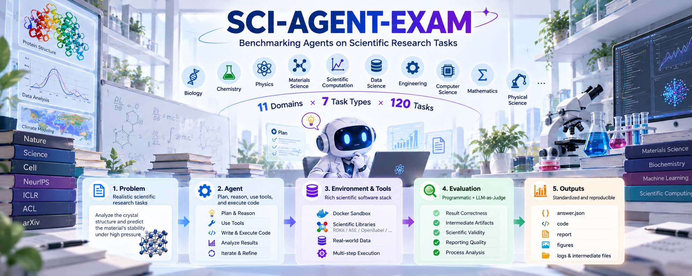
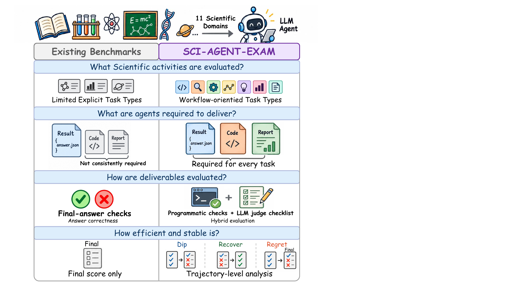
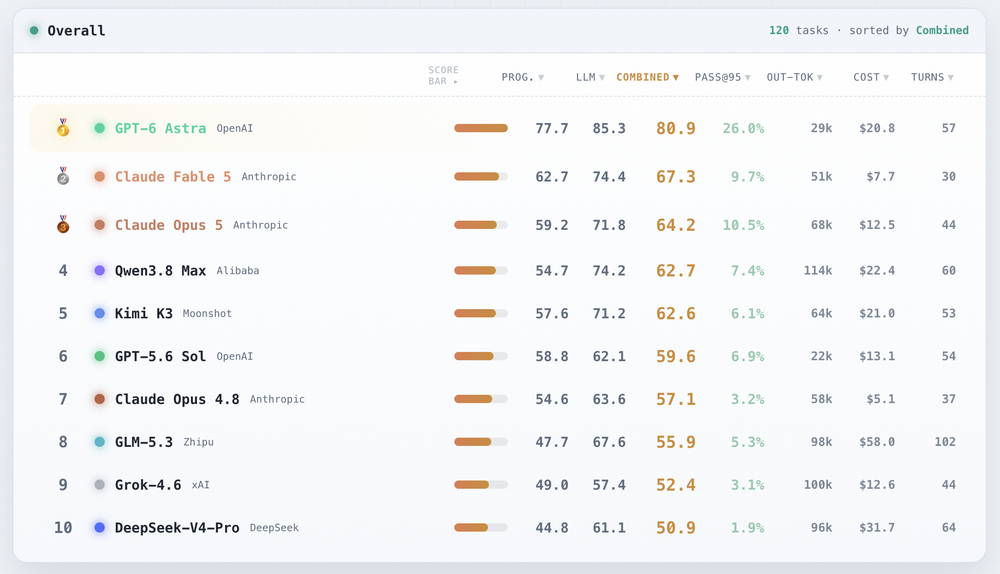
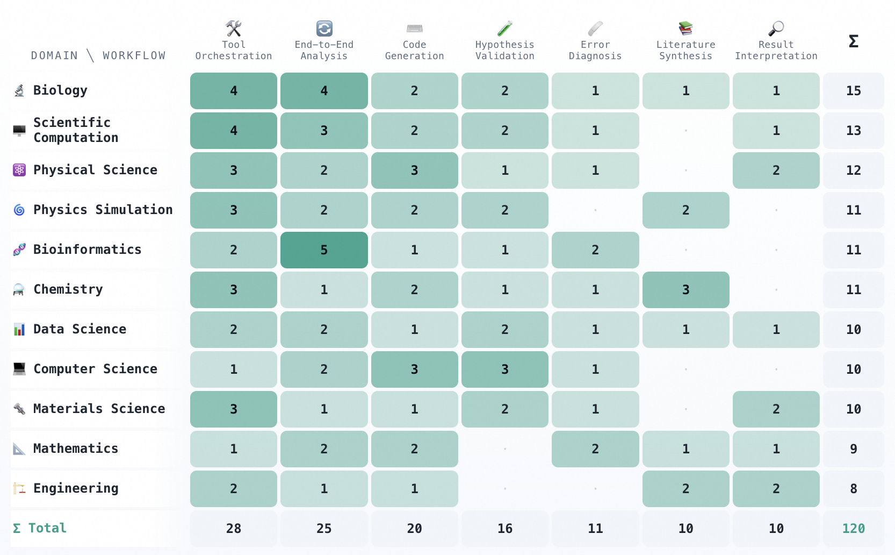

# SCI-AGENT-EXAM: Benchmarking Agents on Scientific Research Tasks

🔗 **Links:** [Paper](https://arxiv.org/pdf/2610.32441) · [Live leaderboard](https://skylenage-ai.github.io/Sci-Agent-Exam/leaderboard/)



Sci-Agent-Exam is a workflow-oriented benchmark for LLM **agents** doing real
scientific software engineering. Every task drops
an agent into a Docker environment with real datasets, source code, and mounted
papers, and asks it to *deliver working artifacts* — code, result tables, a
figure, a short report, and a machine-readable `answer.json` — then scores them
with a **hybrid verifier**: deterministic programmatic checks plus an LLM-judge
rubric, measuring execution correctness and scientific judgement separately.
<!-- 
<p align="center">
  
</p> -->

## Leaderboard

**10 frontier agents**, full task set (11 fields, 7 task types):

- **GPT-6 Astra** sets a frontier reference at **80.9** combined; among contenders **Claude Fable 5** leads at **67.3**.
- Per-run cost spans **$5–58**, with **no correlation to rank**.
- Even the strongest agent clears the **Pass@0.95** reliability bar on only **~¼ of tasks** (contenders **≤10%**) — substantial headroom remains.

Full interactive results on the [live leaderboard](https://skylenage-ai.github.io/Sci-Agent-Exam/leaderboard/).

<p align="center">
  <a href="https://skylenage-ai.github.io/Sci-Agent-Exam/leaderboard/">
    
  </a>
</p>

**Task coverage** — the **120** tasks across **11** scientific domains × **7** research workflows ([`?view=coverage`](https://skylenage-ai.github.io/Sci-Agent-Exam/leaderboard/?view=coverage)):

<p align="center">
  <a href="https://skylenage-ai.github.io/Sci-Agent-Exam/leaderboard/?view=coverage">
    
  </a>
</p>

## Quickstart

**Prerequisites:** Docker, Python 3.12, and `harbor==0.20.0`.

```bash
uv tool install "harbor==0.20.0"   # or: pip install "harbor==0.20.0"

# Run one example task with an agent (the shared base image builds on first run):
bash harness/run_harbor_task.sh bioinformatics-error-diagnosis-01 claude-code <model-id>
```

This needs LLM credentials in your environment — see
[Running an evaluation](#running-an-evaluation) for the full credential setup and
the standalone grader-QC flow.

## What's in this repository

This repository is a compact, self-contained **extract** of that benchmark: the
**harbor run logic** that drives one evaluation end-to-end, **five complete
example tasks** (five domains × five task types), and the **leaderboard** of the
full evaluation. Large-scale batch runners and the complete task set are omitted.
The layout follows the
[Terminal-Bench-Science](https://terminal-bench-science.ai/) conventions, driven
by the [`harbor`](https://github.com/harbor-framework/harbor) runner.

## How a task is evaluated

An **agent** (an LLM driving a coding CLI) is dropped into the task container with
only the instruction and the mounted `data/` directory, and writes its
deliverables to `/home/agent/results/`. A **two-component verifier** then scores
them:

- **Programmatic check** (`tests/check_programmatic.py`) — deterministic
  numerical / schema / file checks.
- **LLM judge** (`tests/llm_judge.py`) — rubric-based grading of scientific
  meaning and reasoning against `tests/rubric.json`.

```
run_harbor_task.sh <task> <agent> [model]
        │
        ▼
   harbor run -p tasks/<domain>/<task> -a <agent> -m <model>
        │
        ├─ builds environment/Dockerfile (on the shared sciagent-bench:base image)
        ├─ runs the AGENT      • sees ONLY /home/agent/data/ + the instruction
        │                      • writes deliverables to /home/agent/results/
        └─ runs the VERIFIER (tests/test.sh, no network egress)
              • check_programmatic.py → programmatic.json
              • llm_judge.py          → llm_judge.json
              • weighted combine      → /logs/verifier/reward.txt
```

**Isolation.** The `tests/` directory (rubric, checks, golden solution) is never
mounted into the agent container — only into the verifier step, which runs with no
network egress — so the agent cannot read or target the grader.
`harness/run_judge.sh` is a standalone QC variant that runs the **golden
solution** through the same pipeline to confirm the grader behaves on a
known-good answer.

## Highlights

- **Real scientific grounding:** tasks derive from peer-reviewed papers,
  competition problems, and open-source codebases — pinned versions for
  contamination control, with injected plausible distractors.
- **Workflow-oriented taxonomy:** 7 task types across the research lifecycle
  (literature synthesis → hypothesis validation → tool orchestration → code
  generation → end-to-end analysis → error diagnosis → result interpretation).
- **Two-channel scoring:** execution (*can it run*) and presentation (*is it
  scientifically right*) are graded independently, weighted per task type.
- **Trajectory-level analysis:** beyond the final score, tracks dip / recover /
  regret behaviors and per-run cost, tokens, and turns.

## Repository layout

```
Sci-Agent-Exam/
├── README.md                   ← this file
├── task-template.toml          ← annotated template for the task.toml schema
├── index.html                  ← root redirect to the leaderboard (host-independent)
├── assets/                     ← figures used in this README
├── harness/                    ← harbor run logic (core evaluation code)
│   ├── run_harbor_task.sh      ← MAIN: run one task through harbor
│   ├── docker_claude_agent.sh  ← in-container agent entrypoint (prompt + setup)
│   ├── build_image.sh          ← build a task image on the shared base
│   ├── base/Dockerfile         ← shared base image (Python, Node, agent CLI, common deps)
│   ├── run_judge.sh            ← standalone verifier flow (grades the golden solution)
│   └── judge_adapter.py        ← routes the judge through an OpenAI-compatible API
├── leaderboard/                ← self-contained results webpage + its data
│   ├── build.py                ← generator: data/leaderboard.json → index.html
│   ├── index.html              ← the rendered leaderboard (open in a browser)
│   └── data/leaderboard.json   ← all scores + model / category metadata
└── tasks/                      ← five example tasks, grouped by domain (see tasks/README.md)
    ├── bioinformatics/bioinformatics-error-diagnosis-01/
    ├── chemistry/chemistry-result-interpretation-02/
    ├── materials-science/materials-science-literature-synthesis-02/
    ├── mathematics/mathematics-code-generation-02/
    └── physics-simulation/physics-simulation-tool-orchestration-01/
```

Each task directory has a fixed structure:

```
<task>/
├── instruction.md           ← the only thing the agent is shown
├── task.toml                ← metadata, I/O schema, scoring task type, verifier env
├── metadata.json            ← domain + bookkeeping (anonymized)
├── README.md                ← human-readable task record (source, license, difficulty)
├── environment/
│   ├── Dockerfile           ← builds on the shared base, installs the task stack
│   ├── requirements.lock    ← exact pip pins captured from the evaluation image
│   └── data/                ← input datasets, source code, mounted papers
├── tests/                   ← the verifier (NEVER shown to the agent)
│   ├── test.sh              ← orchestrator → writes /logs/verifier/reward.txt
│   ├── check_programmatic.py
│   ├── llm_judge.py         ← task-agnostic rubric judge
│   ├── judge_config.json    ← per-task judge inputs
│   └── rubric.json          ← weighted PASS/FAIL criteria
└── solution/                ← golden reference (solve.py/solve.sh + answer.json + artifacts)
```

## The five example tasks

Chosen to span five scientific domains **and** five task types, across the full
scoring-weight range (0.70/0.30 down to 0.20/0.80).

| Domain | Task type | Prog / Judge | Task |
|---|---|---|---|
| Mathematics | code_generation | 0.70 / 0.30 | `mathematics/mathematics-code-generation-02` |
| Bioinformatics | error_diagnosis | 0.65 / 0.35 | `bioinformatics/bioinformatics-error-diagnosis-01` |
| Physics Simulation | tool_orchestration | 0.55 / 0.45 | `physics-simulation/physics-simulation-tool-orchestration-01` |
| Chemistry | result_interpretation | 0.45 / 0.55 | `chemistry/chemistry-result-interpretation-02` |
| Materials Science | literature_synthesis | 0.20 / 0.80 | `materials-science/materials-science-literature-synthesis-02` |

Each task's `README.md` records its external source (paper / dataset / codebase)
and that source's license, and ships its golden reference solution under
`solution/`. See [`tasks/README.md`](tasks/README.md) for one-line descriptions.

## Running an evaluation

**Credentials** (any OpenAI/Anthropic-compatible gateway, or the vendor APIs directly):

```bash
# Used by run_harbor_task.sh (agent + in-container verifier, Anthropic protocol):
export LITELLM_PROXY_API_BASE="https://<your-llm-proxy>"   # LLM proxy base URL
export LITELLM_PROXY_API_KEY="<key>"
# tests/llm_judge.py reads ANTHROPIC_*; run_harbor_task.sh defaults them from the
# proxy vars above if unset:
export ANTHROPIC_BASE_URL="$LITELLM_PROXY_API_BASE"
export ANTHROPIC_API_KEY="$LITELLM_PROXY_API_KEY"
```

For the standalone QC flow (`run_judge.sh`), which routes the judge through an
OpenAI-compatible endpoint via `judge_adapter.py`, also set (e.g. in a top-level
`.env`, which `run_judge.sh` sources):

```bash
export JUDGE_BASE_URL="https://<your-llm-proxy>"
export JUDGE_API_KEY="<key>"
export JUDGE_MODEL="<judge-model-id>"
# If JUDGE_BASE_URL/JUDGE_API_KEY are unset, run_judge.sh falls back to the native
# Anthropic llm_judge.py path (which uses ANTHROPIC_API_KEY).
```

```bash
# Run a task with an agent (the shared base image builds automatically on first run):
bash harness/run_harbor_task.sh bioinformatics-error-diagnosis-01 claude-code <model-id>

# QC the grader against the golden solution (no agent):
bash harness/run_judge.sh mathematics-code-generation-02
```

The bare task slug is resolved to its domain directory; you can also pass
`bioinformatics/bioinformatics-error-diagnosis-01` explicitly.

**Reproducibility.** Each `environment/Dockerfile` builds on the shared
`sciagent-bench:base` image (`harness/base/Dockerfile`: Python 3.11, Node 22, the
agent CLI) and installs the task's scientific stack from
`environment/requirements.lock` — the **exact pip pins captured from the
evaluation images** (Python 3.11.15). The stack is kept out of the base image on
purpose: tasks pin different major versions (e.g. `numpy` 1.24 vs 1.26), so each
task layer installs its own to avoid ABI corruption.

## Notes on anonymity & scope

- Author / institution / infrastructure identifiers have been removed:
  build-pipeline fields, internal image names, writer identities, and regional
  package mirrors are stripped. LLM endpoints are supplied entirely via
  environment variables; model names on the leaderboard and in the figures are
  pseudonymous.
- **Scientific-source attributions are deliberately kept.** Each task cites the
  real paper, dataset, or open-source project it derives from, with that source's
  license (e.g. Smilei / CeCILL-B, MDAnalysis / GPL, pytorch-lightning /
  Apache-2.0, and CC-BY papers). Only sources whose license permits
  redistribution and derivative use are included.

## License

Released under the **Apache License 2.0** (see `LICENSE`). Scientific sources
redistributed within individual tasks retain their own upstream licenses, recorded
in each task's `README.md`.

## Citation

```bibtex
@misc{zhong2026sciagentexam,
      title={SCI-AGENT-EXAM: Benchmarking Agents on Scientific Research Tasks}, 
      author={Tianyun Zhong and Wei Wang and Jialin Li and Jianhong Tu and Liyao Li and Chuqiao Kuang and Tianshi Zheng and Songchi Zhou and Weiqi Zhai and Qile Jin and Jiajia Li and Jiasheng Zheng and Boxi Cao and Yaojie Lu and Hongyu Lin and Shiwei Ye and Bing Zhao and Hu Wei and Lin Qu and Xianpei Han},
      year={2026},
      eprint={2610.32441},
      archivePrefix={arXiv},
      primaryClass={cs.CL},
      url={https://arxiv.org/abs/2610.32441}, 
}
```
