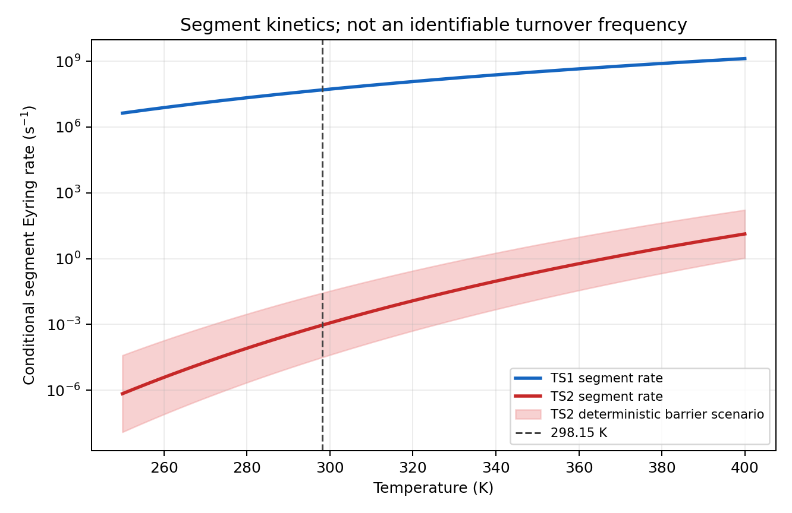

# Evidence assessment for CAl3MgH2- acetone hydrogenation

## Provenance decision

The claim-authoritative result is `segment-report-2026-01` at
`reported_energetics.csv`: the registry marks it final, claim-authoritative, and a
transcription of the peer-reviewed segment energetics. The screening export
`screening-preview-2025-12` is superseded and non-authoritative. Its clean
summary (a 21.59 kcal/mol energy
span, 0.000928 s^-1 predicted TOF, and
`supported` verdict) is internally consistent with
treating TS2's segment barrier as a complete-cycle span, but that premise is
not licensed by the authoritative energy references.

## Mechanistic evidence

TS1 and TS2 each have one imaginary frequency and their reported IRCs connect
A-TS1-B and C-TS2-D, respectively. This validates the two local saddle/minimum
connections, not their dominance or a steady-state catalytic flux. The
structural and charge changes support the proposed chemistry: H2-H3 lengthens
from 0.75 to 1.05 angstrom while
Mg-H2 and O-H3 contract to 1.98 and
1.21 angstrom. TS2 H2/H3 charges are
-0.45/+0.29 |e| with omegaB97XD and -0.48/+0.31 |e| with M06. The
preserved opposite signs and bond changes jointly support heterolytic H2
cleavage.

The source's recovery argument concerns the catalyst-like geometry inside bound
product complex D. D still contains a 2.17 angstrom Mg-O contact and the paper
describes a stabilizing 2.28 angstrom hydrogen bond to the cluster. It does not
supply product-release thermochemistry or a release transition state, so it
does not demonstrate regenerated free catalyst or repeated turnover (Malhan
and Thirumoorthy, 2026, Table 2 and Figure 5).

## Kinetics, references, and uncertainty

The authoritative barriers give segment Eyring rates of
4.92e+07 and 0.000928 s^-1 at 298.15 K. The TS2 event's
reciprocal time is about 18.0 minutes under the TST assumptions. These
are segment-conditioned rates, not a TOF. The +/- barrier scenario changes the
TS2 rate to 0.0271 and
3.17e-05 s^-1; it is deterministic
sensitivity, not a confidence interval.

The reference audit identifies TS1-A (6.96
kcal/mol) and TS2-C (21.59 kcal/mol), but
`c_minus_b` and `d_minus_a` are `not_identifiable` and
`not_identifiable`. A and C are different zeros, so the
inter-segment offset is absent. Combining the displayed profiles would mix
reference states. Together with missing product release, this prevents an
energy span, microkinetic closure, and TOF from being identified.

The study optimized geometries and evaluated frequencies with
omegaB97XD/def2-TZVPP (with M06 as a DFT comparison) and applied
DLPNO-CCSD(T)/def2-TZVPP electronic single points on the DFT geometries. The
modeled uncatalyzed/TS2 barrier contrast corresponds to a factor of
1.93e+38, but it is not an observed
rate enhancement, and its different reactant convention does not repair the
missing cycle reference. The electronic single-point discrepancies are only
0.69 and
0.03 kcal/mol at TS1 and TS2. They
support electronic-energy agreement on shared geometries, not full Gibbs,
standard-state, structural, environmental, or model-form uncertainty.

## Scope, verdict, and follow-up

This is a bare gas-phase anion calculation. Counterion and solvation fields
could differentially stabilize ionic intermediates and reorder the barriers.
Aggregation or alternative low-lying cluster structures could replace the
modeled active site, while decomposition would reduce active-species
availability. The article also notes the lack of an effective
laboratory synthesis route for stable planar-tetracoordinate-carbon species,
and reports no rate, catalyst recovery, or turnover count.

The verdict is **partially_supported**: the two local transformations are
computationally supported, but cycle-level catalytic viability and practical
turnover are not established.

The decisive computational follow-up is a common-standard-state free-energy
cycle including association, B/H2-to-C connection, product release to free
product plus regenerated catalyst, competing paths, and uncertainty, followed
by energy-span or microkinetic analysis. The
experimental follow-up is to realize and characterize the catalyst in a
defined counterion/environment, then measure rate, selectivity, catalyst
recovery, and repeated turnover rather than a single product event.

